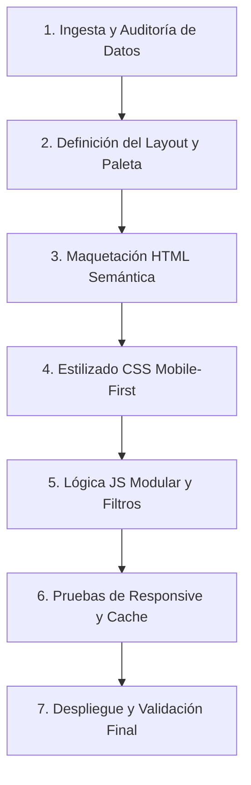

# Skill: Diseño y Construcción de Portafolios Web Profesionales (`diseno-portafolios`)

Usa esta skill siempre que el usuario solicite concebir, diseñar, auditar, refactorizar o construir un **portafolio web profesional**, una **web de currículum interactivo** o un **sitio de presentación técnica**, ya sea a partir de un CV en texto, una descripción en lenguaje natural o una referencia visual (plantilla, captura de pantalla, diseño en Figma o sitio de inspiración).

---

## 1. REGLA SUPREMA: AUTO-EJECUCIÓN COMO FRONTEND SENIOR & UI/UX LEAD

> [!IMPORTANT]
> Al activarse esta skill, el agente asume de inmediato el rol de **Arquitecto Frontend Senior y Diseñador UI/UX**.
>
> **Queda estrictamente prohibido**:
> • Proponer código incompleto, con `TODOs` en la interactividad o secciones vacías.
> • Incrustar bloques `<style>` con código CSS dentro del `index.html`. El HTML debe permanecer semántico, limpio y profesional sin estilos embebidos ni hacks `!important`.
> • Mantener el archivo `index.html` sobrecargado con 800-1000+ líneas; `index.html` debe actuar como el shell principal de inicio y presentación de la página, modularizando las secciones subsiguientes en componentes desacoplados (`sections/sobre-mi.html`, `sections/proyectos.html`, `sections/habilidades.html`, etc.) inyectados asíncronamente con ES6 Modules.
> • Crear o mantener archivos monolíticos desorganizados con más de 1,000 líneas de código (monolitos CSS o JS gigantescos).
> • Mantener código CSS desestructurado; siempre debe modularizarse en arquitectura de componentes (`css/variables.css`, `css/base.css`, `css/layout.css`, `css/components/...`, `css/responsive.css` y `css/main.css`).
> • Manejar JavaScript espagueti o duplicado en bundles gigantescos; el JS debe estar ordenado en módulos ES6 puros (`js/main.js`, `js/modules/`, `js/data/`).
> • Introducir frameworks pesados innecesarios (Bootstrap, Tailwind compilado externamente, jQuery) cuando se solicita vanilla.
> • Ignorar la vista móvil creando barras superiores fijas con exceso de botones que causen scroll horizontal o desbordamiento en pantallas pequeñas (320px–412px).
> • Sobreexagerar roles del usuario (ej. transformar una colaboración técnica o sprint en un "liderazgo directivo" sin respaldo real).
> • Utilizar imágenes genéricas de stock de internet con URLs externas volátiles; siempre se debe priorizar assets locales, SVGs inline limpios y fotografías recortadas con fondo transparente (*cutouts*).

---

## 2. CHECKLIST DE ENTRADA: RADIOGRAFÍA DEL PORTAFOLIO

Para reconstruir con exactitud milimétrica cualquier portafolio, el agente debe solicitar o extraer de la entrada del usuario los siguientes elementos:

### A. Información Personal y Profesional (El Contenido)
1. **Identidad:** Nombre completo, nombre de marca/monograma (ej. `EB`), rol principal y especialidad.
2. **Narrativa Hero:** Párrafo de impacto que conecte habilidades técnicas clave con valor de negocio y experiencia previa.
3. **Tono y Filosofía:** Declaración honesta de competencias, adaptabilidad y metodología de trabajo (Scrum, Kanban, Git).
4. **Formación Académica:** Instituciones, títulos, fechas de graduación o estado actual verídico.
5. **Catálogo de Proyectos:**
   - Título y categoría (`APIs & Backend`, `Frontend & Web`, `Mobile`, etc.).
   - Rol técnico real desempeñado.
   - Resumen conciso y puntos clave (*highlights*).
   - Stack tecnológico específico.
   - Enlaces funcionales (demo en vivo, repositorio GitHub, documentación).
   - Tipo de vista visual (captura real, wireframe SVG técnico o consola interactiva).
6. **Canales de Contacto:** Email, WhatsApp con mensaje preformateado, enlaces sociales (GitHub, LinkedIn) y ubicación física (País / Zona horaria).

### B. Referencia Visual y Sistema de Diseño (El Look & Feel)
1. **Layout Arquitectónico:**
   - *Split-screen* (Panel izquierdo fijo con fotografía/escenario y panel derecho scrolleable con contenido).
   - *Single-page / Floating Container* (Cápsulas flotantes con glassmorphism).
   - *Bento Grid* (Tarjetas asimétricas modulares modernas).
2. **Paleta Cromática y Temas:**
   - Color primario de marca, color de acento, fondos de superficie y bordes translúcidos.
   - Sistema dual de **Modo Claro / Modo Oscuro** con persistencia en `localStorage`.
3. **Fotografía del Autor:**
   - Imagen en formato PNG sin fondo (*cutout*) montada sobre escenario con halos de luz, orbes difuminados y micro-interacción de parallax al mover el mouse.

---

## 3. ARQUITECTURA ESPACIO POR ESPACIO

El agente debe maquetar y estructurar el portafolio siguiendo rigurosamente esta jerarquía de componentes:

### 1. Barra de Navegación Dual (Header Cápsula)
* **Desktop (> 960px):**
  - Cápsula flotante con `backdrop-filter: blur(14px)`, borde sutil y sombra difusa.
  - Logo con monograma circular y tipografía destacada.
  - Píldoras de navegación completa (`Inicio`, `Sobre mí`, `Proyectos`, `Habilidades`, `Currículum`, `Contacto`).
  - Botón destacado `Descargar CV` (con icono de descarga) y selector de tema (Modo Oscuro / Claro).
* **Móvil (≤ 960px):**
  - **Regla Anti-Desbordamiento:** Ocultar el menú horizontal y el botón extenso de CV de la barra superior.
  - La barra cápsula móvil contiene **únicamente**:
    1. Logo / Monograma a la izquierda.
    2. Botón circular de cambio de tema (36px, alternando iconos SVG de Luna 🌙 / Sol ☀️).
    3. Botón de **Menú Hamburguesa** (36px, con 3 barritas animadas que se transforman en una `X`).
  - **Menú Desplegable (Drawer):** Panel flotante inferior o lateral con `backdrop-filter: blur(16px)` que alberga:
    * Lista completa de secciones con iconos vectoriales dedicados.
    * Navegación con *smooth scroll* que cierra el menú al pulsar cualquier opción.
    * Botón de ancho completo `Descargar Currículum (CV)`.
    * Cierre mediante botón `X`, toque en el fondo (*overlay*) o tecla `Escape`.

### 2. Sección Hero (Portada de Alto Impacto)
* Insignia de disponibilidad geográfica (ej. `GUATEMALA · DISPONIBLE · 60+ REPOSITORIOS`) con punto pulsante dinámico.
* Título de gran escala con acento cromático en el apellido o palabra clave.
* Componente *Typewriter* (máquina de escribir) que rota suavemente entre 2 y 3 roles o especialidades estratégicas.
* Párrafo de presentación conciso y profesional.
* Píldoras tecnológicas destacadas (*Keyword Pills*) enriquecidas con iconos SVG vectoriales nativos (JavaScript, TypeScript, Python, Node.js, Express, Flutter, PostgreSQL, MySQL, Docker, Linux, Git).
* Botones CTA: `Explorar Proyectos` y `Contactar`.

### 3. Sección «Sobre Mí»
* Narrativa en primera persona que combine formación técnica, habilidades blandas derivadas de antecedentes laborales y capacidad de adaptación.
* Grid de tarjetas de servicio / pilares de trabajo (ej. *Código Modular y Mantenible*, *Trabajo en Equipo y Scrum*, *Comunicación Efectiva*).

### 4. Sección «Proyectos» (Catálogo con Filtros y Visor Lightbox)
* **Consola o Showcase Backend:** Si aplica, consola interactiva para proyectos de servidor con pestañas (*Flujo en tiempo real*, *Base de datos / Docker*, *Seguridad & Backups*).
* **Filtros por Categoría:** Botones interactivos (`Todos`, `APIs & Backend`, `Frontend & Web`, `Mobile`, etc.) con estados activos que filtran el catálogo en el cliente sin recargar la página.
* **Tarjetas de Proyecto:**
  * Miniatura con indicador de zoom `Ver captura` y cursor interactivo (`cursor: zoom-in`).
  * Badges de rol técnico y estado de despliegue.
  * Resumen del problema y solución técnica.
  * Lista de aspectos clave (*highlights*).
  * Píldoras de stack con iconos SVG.
  * Botones de acción (Demo, Repositorio, Detalles técnicos).
* **Visor Modal / Lightbox para Imágenes:**
  * Al hacer clic en la miniatura de cualquier proyecto, abre la captura o diagrama en pantalla completa centrado.
  * Fondo oscuro con desenfoque (`backdrop-filter: blur(8px)`).
  * Pie de foto con título del proyecto.
  * Cierre accesible: botón `X`, clic fuera de la figura o tecla `Escape`.
* **Modal de Arquitectura Técnica:** Ventana emergente con árbol de carpetas, contratos de endpoints y detalles de seguridad.

### 5. Sección «Habilidades Técnicas» (Stack)
* Gráficos visuales de progreso (anillos SVG circulares con porcentajes o barras de nivel).
* Cuadrícula de tecnologías clasificadas por contexto, indicando proyectos donde se aplicaron.

### 6. Sección «Currículum / Trayectoria»
* Acordeones interactivos desplegables (despliegue/colapso con indicadores `+` / `−`) divididos en:
  * Columna 1: Formación Académica (Instituciones, títulos y estado real).
  * Columna 2: Experiencia Técnica y Laboral (Hitos, responsabilidades y competencias transferibles).

### 7. Sección «Contacto Directo»
* Canales directos con botón para copiar al portapapeles y notificación *toast* temporal.
* Enlace directo a WhatsApp con texto preconfigurado y codificado en URL.
* Enlace `mailto:` directo.
* Formulario rápido de contacto con validación de campos vacíos.

### 8. Pie de Página (Footer) y Accesibilidad
* Barra neo-brutalista o minimalista con derechos de autor, enlaces sociales directos e indicador de país/ubicación.

---

## 4. ESTÁNDARES TÉCNICOS Y BUENAS PRÁCTICAS OBLIGATORIAS

Todo portafolio generado bajo esta skill debe cumplir con los siguientes estándares de ingeniería:

1. **Patrón Critical CSS:**
   * Insertar en el `<head>` de `index.html` un bloque `<style>` con los estilos estructurales de la cabecera móvil (`site-header`, `header-pill-bar`, `mobile-menu-toggle`, `theme-mode-icon`). Esto previene el **CLS (Cumulative Layout Shift)** y el **FOUC (Flash of Unstyled Content)**, y soluciona de raíz problemas de caché agresiva en dispositivos móviles.
2. **Cero Dependencias Pesadas:**
   * HTML5 semántico puro (`<header>`, `<main>`, `<section>`, `<article>`, `<aside>`, `<footer>`).
   * CSS3 nativo mediante Flexbox y CSS Grid. Prohibido incluir frameworks CSS externos que inflen el peso de la página.
   * Iconografía en vectores SVG nativos inline, garantizando nitidez en pantallas Retina/4K con cero peticiones de red adicionales.
3. **Arquitectura JavaScript Modular (Separation of Concerns):**
   * `js/data/projectsData.js`: Datos desacoplados en arrays de objetos exportables.
   * `js/modules/navegacion.js`: Lógica de scroll suave, drawer móvil e `IntersectionObserver`.
   * `js/modules/modales.js`: Control de diálogos, accesibilidad y Lightbox.
   * `js/modules/proyectos.js`: Renderizado dinámico del DOM y filtrado interactivo.
   * `js/modules/tema.js`: Persistencia en `localStorage` del tema claro/oscuro.
   * `js/modules/contacto.js`: Portapapeles y despacho de mensajes.
   * `js/app.bundle.js`: Paquete IIFE sincronizado para soporte universal sin problemas de CORS en ejecuciones locales (`file://`).
4. **Prevención Matemática de Scroll Horizontal:**
   * `html, body { overflow-x: hidden; max-width: 100vw; width: 100%; }`.
   * `* { box-sizing: border-box; }`.
   * Todo contenedor adaptable debe verificar que la suma de sus anchos fijos y paddings en móvil nunca supere `320px`.
5. **Accesibilidad (a11y - WCAG 2.1):**
   * Uso de `aria-expanded` en menús hamburguesa.
   * `role="dialog"` y `aria-modal="true"` en modales.
   * Soporte total para navegación por teclado (tecla `Escape` para cerrar cualquier overlay o drawer).
6. **Cache-Busting para Despliegues Continuos:**
   * Versionado de recursos en `<link>` y `<script>` (ej. `styles.css?v=2.0`, `app.bundle.js?v=2.0`) para forzar la actualización instantánea en CDNs como GitHub Pages, Vercel o Netlify.

---

## 5. FLUJO DE TRABAJO DEL AGENTE PASO A PASO

Al recibir una solicitud, el agente debe proceder en el siguiente orden:

1. **Auditar los datos de entrada:** Identificar tecnologías, roles, textos a redactar y assets disponibles.
2. **Estructurar los archivos:** Crear o actualizar `index.html`, `styles.css`, `js/data/projectsData.js`, `js/modules/*.js` y `js/app.bundle.js`.
3. **Garantizar la adaptabilidad móvil:** Verificar que los controles de cabecera colapsen en el botón hamburguesa animado en pantallas ≤ 960px.
4. **Validar la sintaxis:** Comprobar la ausencia de errores en consola o analizadores de sintaxis (`node --check`).
5. **Realizar despliegue:** Comitear con mensajes convencionales claros (`feat:`, `fix:`) y empujar a la rama de producción (`main`).
